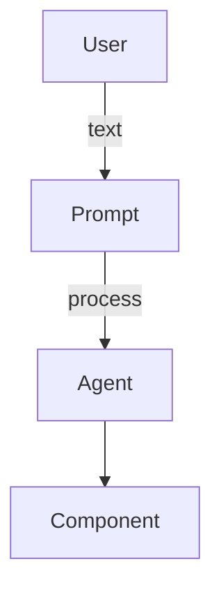
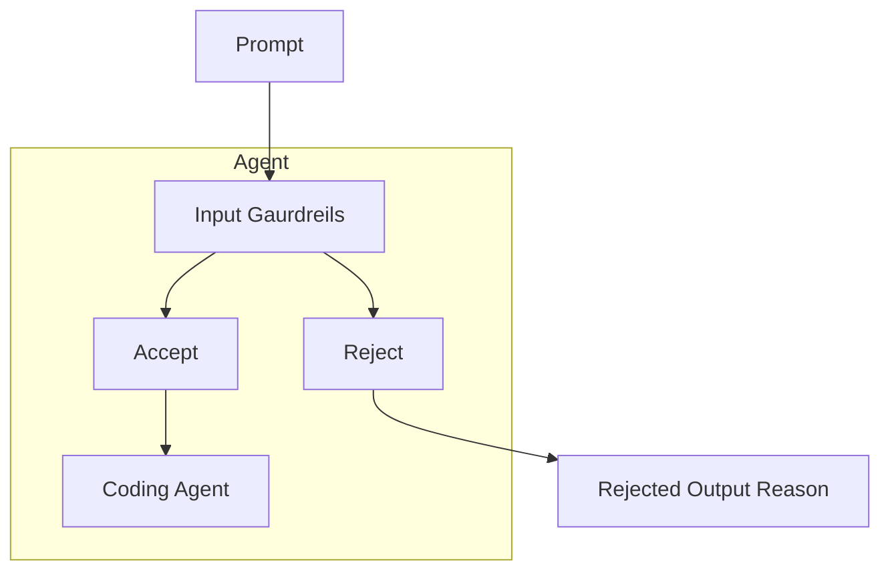

### Definition

**Kira** : Kira is an ai agent for frontend component creater using nextjs typescript and openai using openai agent sdk

## features

- Create Components by prompting
- make changes to existing components
- get access to code
- see preview on browser

## Tech Stack

- Nodejs
- Typescript
- openai SDK

## Working

### High Level Architecture Diagram

### Agent Low Level Architecture

